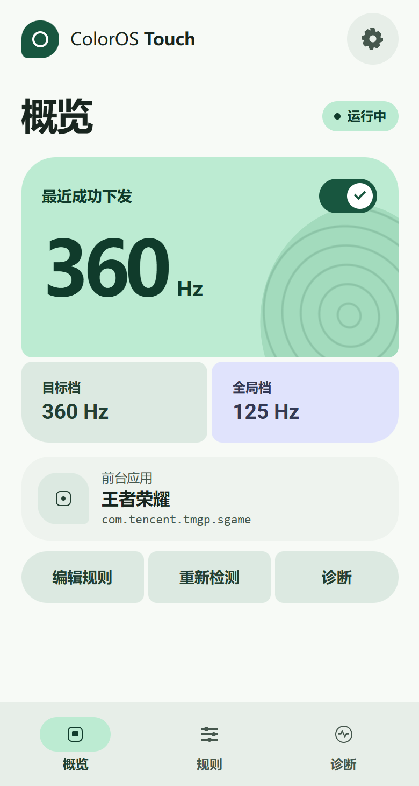
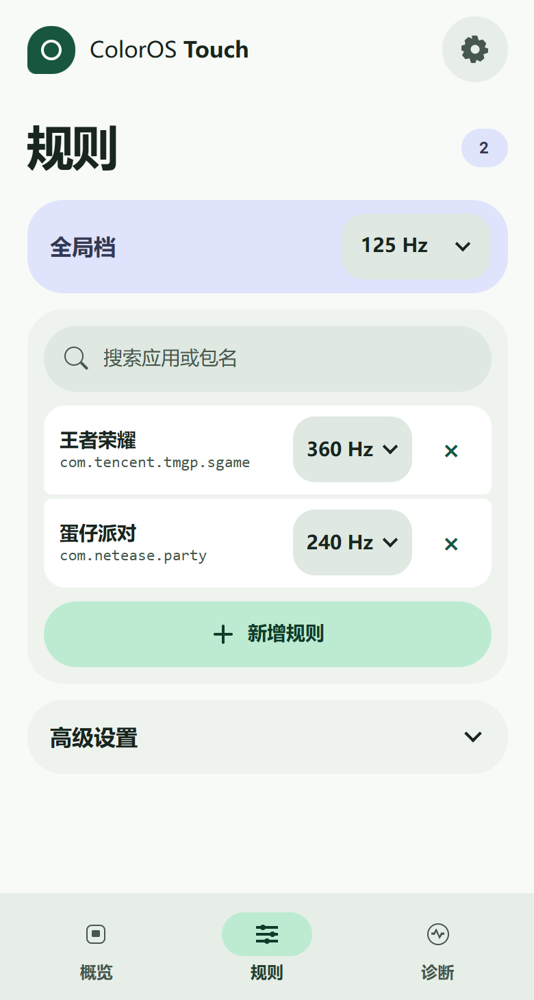

# ColorOS 触控采样率优化

[](https://github.com/FIOIU8/ColorOSDynamic/releases)
[](LICENSE)

按前台应用自动切换 ColorOS 触控采样率档位的 KernelSU / Magisk 模块。模块默认关闭，安装后可在支持 WebUI 的模块管理器中启用。

<p>
  
  
</p>

> **正式版**
>
> 模块会调用厂商触控 HAL 指令并修改系统运行状态。使用前请自行评估风险、备份重要数据，并保留一个已验证的旧版本安装包。因使用本模块造成的任何问题由使用者自行承担。
>
> 本项目与 OPPO / ColorOS 官方无关。

## 两个安装包

从 [Releases](https://github.com/FIOIU8/ColorOSDynamic/releases) 下载并**只安装其中一个**：

| 安装包 | 后端 | 说明 |
| --- | --- | --- |
| `ColorOSDynamic-vX.Y.Z-shell.zip` | Shell | 不含 Rust 二进制，固定使用 Shell 事件监听，建议日常使用。 |
| `ColorOSDynamic-vX.Y.Z-rust-arm64.zip` | Rust | 包含 Rust 监听器，固定使用 Rust 后端，仅支持 `arm64-v8a`。 |

两个包各自包含完整的模块文件和配置逻辑，不需要叠加安装，也不要在升级时混装。Rust 版启动失败时不会回退 Shell，原因会显示在 WebUI「诊断」页并持续重试。

## 功能

- 按前台应用选择触控采样率档位，全局档位可单独设置。
- 默认关闭；开关、规则、映射、应用名称和特殊应用名单在升级时保留。
- WebUI 提供概览、规则编辑、诊断、应用名称映射和高级设置。
- 息屏、锁屏或无法确认前台时回到全局档位并暂停前台查询。
- 模块不申请网络权限，也不访问互联网。

## 前置条件

- ColorOS 13+ / Android 13+。
- 已 root，并安装 KernelSU 或 Magisk；建议使用支持 WebUI 的管理器。
- Rust 版仅支持 `arm64-v8a`；其他设备请使用 Shell 版。

## 安装

1. 从 [Releases](https://github.com/FIOIU8/ColorOSDynamic/releases) 下载对应安装包。
2. 在 KernelSU / Magisk 管理器中安装 ZIP 并重启。
3. 打开模块 WebUI，在概览页启用模块。
4. 在「规则」页添加应用与目标档位。

### 升级

直接在管理器中安装同版本类型的新 ZIP，开关、规则、映射和应用名称会保留。旧观察器模式会自动迁移为名单轮询。从 Shell 版换到 Rust 版（或反向）前，建议先备份配置；安装另一种版本时应先卸载旧包再安装，避免两个包混装。

### 卸载

在模块管理器中卸载并重启。卸载脚本会先停用服务，然后由管理器移除模块文件。

## 使用说明

- WebUI 的「最近成功下发」表示厂商指令返回成功；模块无法读取硬件当前实际频率。
- WebUI 诊断页显示当前安装包的后端类型、服务状态、前台应用、监听方式和最近日志。
- 部分游戏的游戏助手边缘滑动可能受触控档位影响，遇到问题请先在 WebUI 中停用对应规则并反馈。

## 监听与息屏

Shell 版和 Rust 版使用相同的规则和硬件命令。事件明确时直接更新前台，焦点不明时查询系统。亮屏期间每 60 秒校准一次，名单应用可配置更短间隔。确认息屏后回到全局档并暂停前台查询。若本次事件连接已确认亮屏和息屏事件，息屏期间阻塞等待；无法确认事件覆盖的设备会继续低频检查电源状态。

服务只在状态变化时发布状态，没有周期心跳。Shell 负责配置、状态、规则和 HAL 调用。Shell 版通过 `logcat` 监听事件；Rust 版由 Rust 监听器读取、识别和合并事件，启动失败时保持 Rust 后端并重试，不会切换回 Shell。WebUI 的定时刷新只在可见的概览页工作，日志按需读取。

## 开发与打包

```sh
node --test tools/test_rate_layout.js
cargo fmt --manifest-path native/Cargo.toml -- --check
cargo clippy --locked --all-targets --manifest-path native/Cargo.toml -- -D warnings
cargo test --locked --manifest-path native/Cargo.toml
bash tools/package_module.sh --worktree
```

打包脚本默认使用 Python 3；Windows 上会自动回退到 `python`，也可以用 `COLOROS_PYTHON` 指定解释器。默认以 `HEAD` 的模块内容打包，`--worktree` 读取本地改动。只传 `--worktree` 时生成 Shell 版；同时提供 Rust 二进制时生成 Shell 版和 Rust 版两个独立 ZIP：

```sh
rustup target add aarch64-linux-android
ANDROID_NDK_HOME=/path/to/ndk bash tools/build_native.sh
bash tools/package_module.sh --worktree --rust native/target/aarch64-linux-android/release/touch-listener
```

仅用于 x86_64 模拟器隔离验证的测试二进制（不会进入发布 ZIP）：

```sh
rustup target add x86_64-linux-android
ANDROID_NDK_HOME=/path/to/ndk bash tools/build_native.sh --target x86_64
```

WebUI 交互测试需要本机安装 Playwright：

```sh
npm i playwright
node tools/test_webui.js
```

在 Android 模拟器中运行 `tools/verify_on_device.sh` 时，把脚本、`tools/event_fixtures.tsv` 和仓库 `module/` 目录的内容分别推到新建的 `/data/local/tmp/coloros-verify.*` 目录与该目录下的 `module/`。脚本根据 `module/bin/touch-listener` 是否存在写入 `module/edition.conf`，测试 Shell 或 Rust 版本；发布 ZIP 仍只接受 arm64 Android ELF。`tools/measure_listener.sh` 用同一套隔离环境输出 Shell/Rust 的相对 CPU、唤醒和调用次数，模拟器数据只用于判断方向。

```sh
# 设备端隔离度量（Rust 测试二进制需先放入 module/bin/）
adb shell "cd /data/local/tmp/coloros-measure.XXXX && /system/bin/sh measure_listener.sh 3"
```

## 发布流程

1. 更新 `module/module.prop` 中的 `version` 与 `versionCode`。
2. 在 Actions 手动运行 **Draft module release**。
3. 检查工作流生成的两个 ZIP：
   - `ColorOSDynamic-vX.Y.Z-shell.zip`
   - `ColorOSDynamic-vX.Y.Z-rust-arm64.zip`
4. 发布草稿。

工作流会先运行脚本语法检查、Node 测试和 cargo fmt/clippy/test，再构建 arm64 Rust 监听器并创建草稿 Release。

## 真机功耗与兼容性验收

在同一台 ColorOS 手机上对比模块关闭、Shell 版和 Rust 版。先让各组使用同一触控档位以衡量监听成本，再启用正常规则，验证真实使用时的触控和整机耗电。分别记录亮屏静置、定时切换应用和息屏静置三组场景。测试时拔掉充电线，保持亮度、刷新率、网络和交互脚本一致，交错重复各组。

用 Perfetto 记录模块进程及其子进程的 CPU 时间、调度唤醒和进程启动。核对 `dumpsys` 次数、HAL 调用和前台切换时延。电量使用设备可读的电量计或功耗轨。另测分屏、悬浮窗、锁屏/AOD、监听中断和长时间息屏。只有同等正确性和切换时延下 Rust 的进程 CPU 时间或唤醒次数相对 Shell 改善至少 20%，且超出重复测试波动，才考虑把 Rust 版作为推荐版本。

## 反馈

请通过 [GitHub Issues](https://github.com/FIOIU8/ColorOSDynamic/issues) 反馈问题，并附上设备型号、ColorOS 版本、安装包类型（Shell / Rust）、复现步骤和诊断页日志。

## 作者与许可证

作者 / 维护者：**FIOIU8**

本项目使用 [MIT License](LICENSE) 发布。
